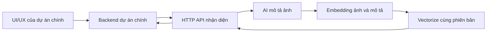

# Tích hợp nhận diện tem vào UI/UX hiện có

Phạm vi hiện tại: ảnh chụp hiện vật → AI mô tả nội dung nhìn thấy → semantic scene guard → embedding **ảnh và mô tả trong cùng một input** → Vectorize → quyết định theo cosine threshold/margin. Policy `algorithm-first-v1` đã triển khai online; hỗ trợ reject-only hard-negative guard cho Phật Bà Quan Âm, Hoàng hậu Ngọc Trúc, Cánh cửa chạm rồng, Hai thiếu nữ và em bé và Em Thúy theo các bank được owner duyệt. Geometry/local-feature/homography/affine đã được xóa khỏi runtime, cấu hình và API; hệ thống không còn family routing hoặc geometry rescue. Không có quét video liên tục hoặc MindAR. API không bắt buộc crop; camera của công cụ hiện có khung dọc/ngang và chỉ gửi vùng bên trong, chụp từ pixel video gốc trước khi chuẩn hóa JPEG. Đây là căn chủ thể thủ công, không phải detector. Luồng file upload/helper tích hợp vẫn giữ toàn ảnh; đội UI đích cần tái hiện mapping cover/zoom/guide nếu muốn cùng hành vi camera. Giao diện ở `/` là công cụ quản trị/kiểm tra, không phải UI bắt buộc của dự án chính.

## Ranh giới tích hợp



UI giữ camera/chọn ảnh và cách trình bày kết quả sẵn có. Backend đích xác thực người dùng, áp hạn mức theo người dùng và gọi dịch vụ. Browser không nhận token dịch vụ hoặc API key model. Một deployment hiện phục vụ **một danh mục và một bên tích hợp được tin cậy**; chưa có cô lập nhiều tenant. Dùng deployment riêng nếu cần nhiều danh mục độc lập trước khi bổ sung tenant isolation.

Gói bàn giao:

- [OpenAPI 3.1](openapi.json): hợp đồng đã triển khai cho ba endpoint bên dưới.
- [client.mjs](client.mjs): adapter backend dùng Fetch/FormData/Blob, phù hợp Node 22 và các runtime tương đương.
- [prepare-image.js](prepare-image.js): hàm browser độc lập UI, gửi toàn ảnh. Có thể tái sử dụng hoặc thực hiện chuẩn hóa tương đương ở backend đích.
- [STAMP_EVALUATION.md](STAMP_EVALUATION.md): cách xác nhận chất lượng trên chín mẫu tem.

## Cấu hình và dữ liệu tham chiếu

1. Áp dụng migrations, bao gồm `0005_description_integration.sql`. Local: `npm run dev:setup`. Chưa áp migration remote hoặc deploy trong lần thay đổi này.
2. Đặt `OPENROUTER_API_KEY`; `RECOGNITION_PIPELINE=image-description-v1`; `DESCRIPTION_MODEL=google/gemini-2.5-flash`; `OPENROUTER_MODEL=google/gemini-embedding-2`; 1536 chiều.
3. Đặt secret `RECOGNITION_SERVICE_TOKEN` ngẫu nhiên, tối thiểu 32 ký tự, ở Worker và backend đích; không dùng biến `VITE_*`. Không có token thì API tích hợp trả `503 SERVICE_NOT_CONFIGURED`. Khi hostname được Cloudflare Access bảo vệ, backend còn cần Access service token hợp lệ cho hostname đó.
4. Tạo hiện vật bằng API quản trị, có thể truyền `external_object_id` cùng `name`; với hiện vật cũ, dùng `PATCH /api/admin/artifacts/{id}` với JSON `{"external_object_id":"ID_TRONG_DU_AN_CHINH"}`. ID có 1–128 ký tự chữ/số/`_.:-`, bắt đầu bằng chữ hoặc số, duy nhất trong deployment. API quản trị vẫn dùng Cloudflare Access, không chấp nhận token nhận diện.
5. Nhập ảnh tham chiếu qua công cụ quản trị. AI tạo mô tả từ **ảnh**, không từ tên file/tên hiện vật/nhãn đáp án. Mô tả và vector được lưu để khôi phục khi lỗi; query không được tự thêm vào reference.
6. Ảnh cũ hiện “Cần cập nhật pipeline”. Dùng **Cập nhật mô tả và vector** hoặc `POST /api/admin/images/{id}/reprocess`. Thao tác này có thể gọi model trả phí. `/reindex` chỉ dành cho cùng pipeline, không tự chuyển dữ liệu cũ. Không cần xóa rồi nhập lại ảnh.
7. Kiểm tra `GET /api/v1/catalog`: ít nhất hai hiện vật có reference cùng pipeline và mọi hiện vật đang dùng đều có external ID. Vectorize có thể cập nhật chậm sau upsert; nhận diện trả lỗi `CATALOG_INDEXING` nếu thiếu đối thủ để xác minh.

`DAILY_EMBEDDING_LIMIT` giữ nguyên tên cấu hình, nhưng đếm số lượt **gọi model đã đặt chỗ**. Pipeline đặt chỗ 2 lượt nguyên tử trước lời gọi trả phí đầu tiên: một mô tả, một embedding. Semantic guard có thể dừng sau mô tả nên không gọi embedding, nhưng cả 2 lượt đã đặt chỗ vẫn được tính, tương tự trường hợp mô tả lỗi. Retry reference có mô tả hợp lệ chỉ cần một lượt embedding; reindex vector đã lưu không gọi model. Đây không phải ngân sách USD.

Bộ production hiện tại là32 refs (`crop-bank32-session2-v1`, loạiR1090): giữ nguyên30 reference cũ và thêm2 góc mặt lá Bình phong được chọn từ buổi chụp2; không thay pipeline hoặc external IDs. Đối với các reference đóng gói này, Vectorize truy hồi ứng viên nhưng quyết định dùng cosine chính xác từ cache D1 để tránh điểm ANN xấp xỉ vượt ngưỡng0,8 (đã gặp0,8000294 thay vì0,79997178). Không đổi threshold/margin/hard-negative; cache approved thiếu/hỏng thì fail-closed. Bộ này chỉ có evidence phát triển cùng phiên/hậu kiểm, chưa phải precision/recall độc lập.

Signature gồm embedding model/version, tiền xử lý, pipeline, description model và phiên bản prompt. Pipeline mới dùng namespace Vectorize theo hash signature; không tìm lẫn vector ảnh thuần. Thay model/prompt cần tạo lại reference và đánh giá lại ngưỡng. `0.8/0.05` vẫn là ngưỡng khởi đầu chưa hiệu chỉnh cho ảnh thật.

## API nhận diện

| Endpoint | Mục đích |
| --- | --- |
| `GET /api/v1/catalog` | Kiểm tra danh mục, ID và pipeline |
| `POST /api/v1/recognitions` | Nhận diện một ảnh, trả phản hồi đồng bộ |
| `GET /api/v1/recognitions/{request_id}` | Lấy lại phản hồi/trạng thái, không gọi model |

Tất cả yêu cầu có `Authorization: Bearer <service token>`. Đây là API backend; request có header `Origin` bị từ chối. Token tích hợp không cấp quyền sửa/xóa danh mục.

POST dùng `multipart/form-data`, đúng một trường `file`; có `Idempotency-Key` ổn định cho mỗi lần người dùng xác nhận gửi. Không nhận description, nhãn dự đoán, ngưỡng hay margin từ client.

Đầu vào chuẩn: JPEG RGB 8-bit, đã xoay theo EXIF và bỏ EXIF, cạnh ngắn ít nhất 64 px, cạnh dài tối đa 1600 px, tối đa 15 MiB; toàn request tối đa 18 MiB. `prepareRecognitionImage(file)` áp dụng các quy tắc tiền xử lý của app trên **toàn ảnh**, không hiển thị crop. Backend kiểm tra giới hạn byte, cấu trúc header JPEG, kích thước và EXIF trước khi gọi model. Đây là kiểm tra cấu trúc, không phải giải mã đầy đủ JPEG; provider vẫn có thể từ chối dữ liệu nén bị hỏng. Chưa có dịch vụ server chuyển đổi PNG/WebP/HEIC; adapter phía dự án đích cần chuẩn hóa ảnh hoặc dùng helper browser.

Ví dụ adapter trong backend:

```js
import { createRecognitionClient } from './integration/client.mjs';

const recognition = createRecognitionClient({
  baseUrl: process.env.RECOGNITION_URL,
  token: process.env.RECOGNITION_SERVICE_TOKEN,
  accessClientId: process.env.CF_ACCESS_CLIENT_ID,
  accessClientSecret: process.env.CF_ACCESS_CLIENT_SECRET,
});

// Sau khi backend kiểm tra phiên đăng nhập, quyền và hạn mức của người dùng.
// actionId phải được backend lưu/gắn với lần gửi để dùng lại khi mất phản hồi.
const result = await recognition.recognize(normalizedJpegBlob, actionId);
if (result.status === 'matched') {
  // Lấy tên/nội dung từ database dự án chính bằng result.external_object_id.
}
```

Phản hồi mẫu minh họa, không phải số đo độ chính xác:

```json
{
  "request_id": "d2604664-91fe-4d41-99e7-91e80a0e3f5a",
  "status": "matched",
  "external_object_id": "stamp-em-thuy",
  "reason": "threshold_and_margin_passed",
  "pipeline_version": "image-description-v1",
  "pipeline_signature": "...",
  "catalog_revision": 17,
  "candidates": [
    {"external_object_id": "stamp-em-thuy", "score": 0.91},
    {"external_object_id": "stamp-giong", "score": 0.72}
  ],
  "timings": {"description_ms": 1200, "embedding_ms": 800}
}
```

- `matched`: đạt ngưỡng và chênh lệch; có external ID.
- `uncertain`: điểm đủ cao nhưng hai ứng viên gần nhau, cảnh có nhiều hiện vật, không thấy rõ hiện vật, hoặc bị hard-negative chặn; external ID là null. Các reason semantic là `multiple_artifacts` và `no_clear_artifact`; nên hướng dẫn chụp gần một hiện vật. `hard_negative_conflict` dành cho ảnh giống một trong các bank negative đã duyệt cho target tương ứng (hai tượng, Cánh cửa chạm rồng, Hai thiếu nữ và em bé, Em Thúy). Guard chỉ từ chối, không trả runner-up và không thêm hiện vật vào catalog.
- `no_match`: điểm chưa đạt ngưỡng; external ID là null. Không khẳng định ảnh chắc chắn nằm ngoài danh mục.
- HTTP 4xx/5xx: lỗi ảnh, danh mục, hạn mức hoặc dịch vụ; không chuyển thành `no_match`.

Phản hồi có `decision_version`, `decision_source` và `semantic_guard`. Khi scene guard chặn, `status=uncertain`, `candidates=[]`, `embedding_ms=0`; đây không phải `CATALOG_INDEXING`. Không có geometry reason, family field hoặc geometry field trong API.

Cosine không phải xác suất; không hiển thị score 0.91 thành “đúng 91%”. Backend/UI đích quyết định cách diễn đạt ba trạng thái nghiệp vụ. Không cần đưa description, tham số model hay bảng điểm vào luồng khách tham quan.

## Gửi lại, thời gian chờ và đồng thời

- Cùng key và cùng byte ảnh trả lại phản hồi gốc trong 24 giờ, kể cả lỗi đã hoàn tất và dù danh mục/config thay đổi sau đó. Đây là khôi phục **cùng hành động**, không phải nhận diện ảnh mới. Header `X-Idempotent-Replay: true` đánh dấu phản hồi đã lưu.
- Cùng key với byte ảnh khác trả `409 IDEMPOTENCY_CONFLICT`. Giữ nguyên JPEG đã chuẩn hóa khi khôi phục; không mã hóa lại ảnh rồi dùng cùng key.
- Request song song cùng key trả `409 REQUEST_IN_PROGRESS` và `Retry-After: 3`; không chạy thêm pipeline. Backend có thể kiểm tra lại bằng GET. Client mẫu không tự retry POST.
- Nếu tiến trình ngắt trước khi lưu phản hồi, sau 120 giây trả `REQUEST_OUTCOME_UNKNOWN`; không tự tiếp quản và gọi lại model. Hành động mới dùng key mới có thể phát sinh phí mới. Không hứa xử lý đúng một lần tuyệt đối tại provider.
- Mỗi lời gọi provider có timeout 25 giây. Client backend mặc định chờ 90 giây; cấu hình timeout proxy phù hợp. UI hiển thị trạng thái xử lý từ lúc gửi, không cần đổi camera/UI có sẵn.
- Reference import vẫn đồng bộ, có lưu mô tả/vector từng bước và khóa retry. Chưa có queue, webhook hoặc khôi phục tự động bản ghi pending do tiến trình bị ngắt. Với chín mẫu, chuẩn bị danh mục trước khi mở cho người dùng; bổ sung queue nếu yêu cầu nhập hàng loạt xuất hiện.
- Dịch vụ không lưu ảnh/description query trong D1/R2; chỉ giữ hash, trạng thái và phản hồi nhận diện 24 giờ. Ảnh vẫn được gửi tới provider để xử lý; việc giữ dữ liệu tại provider phụ thuộc cấu hình/tài khoản của bên triển khai.

## Điều kiện bàn giao sang dự án chính

Đã có: pipeline dùng chung, migration, hợp đồng HTTP, adapter backend, helper chuẩn hóa không phụ thuộc UI, kiểm thử bằng provider mô phỏng. Chưa thực hiện: deploy remote, import trả phí/chuyển toàn bộ reference thật, kiểm chứng model thật và hiệu chỉnh ngưỡng tại bảo tàng.

Khi đội dự án chính cung cấp backend/hosting, thống nhất ID hiện vật, cách cấp token, timeout và ánh xạ trạng thái UI. Trước rollout, chạy smoke test trên staging riêng và bộ ảnh thật độc lập; kiểm tra camera điện thoại, mạng gián đoạn, khả năng khôi phục phản hồi và hạn mức người dùng ở backend đích.

## Cơ sở kỹ thuật

- [OpenRouter multimodal embeddings](https://openrouter.ai/docs/api_reference/embeddings): text và image có thể nằm trong cùng input để tạo joint embedding.
- [OpenRouter image inputs](https://openrouter.ai/docs/guides/overview/multimodal/images): ảnh được gửi cho model mô tả qua image_url.
- [Cloudflare Vectorize namespaces](https://developers.cloudflare.com/vectorize/reference/client-api/): phân vùng tìm kiếm trong một index.
